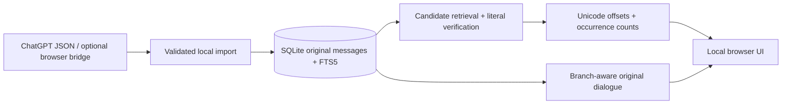

# Chat Recall

[](https://github.com/hotpotkiller/chat-recall/actions/workflows/checks.yml)
[](LICENSE)

**Find the exact words in your ChatGPT conversations, then read the original exchange.**

Chat Recall is a local-first search prototype built with Python's standard library,
SQLite FTS5 and plain JavaScript. It searches message text, counts overlapping
occurrences, preserves Unicode highlight offsets and opens the matching branch
of a conversation. No Python packages, frontend build step or model are required
for exact search.

## Try the synthetic demo

```sh
git clone https://github.com/hotpotkiller/chat-recall.git
cd chat-recall
make bootstrap
CHAT_RECALL_DATA_DIR=.runtime/demo python3 -m chat_recall serve --demo --open
```

Requires Python 3.11+ with SQLite FTS5. Open http://127.0.0.1:8765 if the browser
does not open automatically. Use another port with `--port 8766` if needed.

Try `recovery key`, `STRASSE`, `ana` or `中文`. The demo contains synthetic data.
For your own archive, run `python3 -m chat_recall serve --open` and import an
extracted ChatGPT conversations JSON file through the app. Files remain local.

**Current defaults:** Exact search enabled; Smart/embedding processing disabled;
automatic browser importing off. Models are never downloaded automatically.

## What it does

- **Verified exact search:** Unicode casefold matching, optional case sensitivity,
  original-text highlights and exhaustive paginated results.
- **Useful result reading:** explicit conversation actions, source links, nearby
  dialogue and branch-aware viewing of regenerated replies.
- **Safe asynchronous UI:** old dialogue responses cannot overwrite newer results;
  query clearing and filter/page changes invalidate stale viewer state.
- **Reliable local imports:** source/account namespaces, idempotent updates,
  preserved original messages and explicit partial-coverage reporting.
- **Experimental browser bridge:** paired loopback import, persisted checkpoints,
  respectful 429 backoff and finite optional backfill. It is off by default and
  does not establish complete account/project/archive coverage.

Optional embedding and reranking adapters are included for research. They are not
needed for the default application and are not activated by the commands above.

## Architecture



The SQLite index narrows candidates; final literal checks verify source text.
Stored offsets use Unicode code points, which the browser converts safely for
astral characters. Conversation ancestry keeps regenerated branches separate.
See [architecture](docs/architecture.md) and [browser setup](docs/browser-helper.md).

## Tests and measured results

```sh
make check
make check-js       # Node.js required; NODE=/path/to/node is supported
make eval          # small synthetic evaluation; no model or external API
```

Checks include real temporary Git/worktree workflows, local HTTP integration,
Unicode and overlapping-hit oracles, namespace/branch isolation, inert imported
markup, async UI races, and synthetic browser-helper retry cases. Tests do not
require personal histories, provider credentials or paid model calls.

An existing **5,000-conversation / 25,000-message synthetic benchmark** preserved
all oracle-expected exact results across all pages. In the recorded single-run
timing sample, first-page p95 changed from **906.422 ms to 133.612 ms** after a
candidate-containment optimization. These are fixture-specific measurements,
not a production latency guarantee. Raw reports and the reproduction command
are in [validation](docs/VALIDATION.md).

## Privacy and limitations

This public repository contains source code, synthetic fixtures and benchmark
reports. Personal chats, credentials, databases, model files, machine-specific
operator records and private development history are not included. Default
runtime data lives in the platform's private app-data directory; use
`CHAT_RECALL_DATA_DIR` for an explicit isolated location.

This is an independent prototype, not an official OpenAI product. Search only
covers successfully imported messages. The optional browser adapter uses
undocumented endpoints and may stop working. Full account, archived/project
discovery, native-app freshness, remote hosting and a signed native wrapper are
not established features. Imported markup is displayed as inert source text.

## Development and maintenance

Functionality and reproduced bugs take priority over ingestion experiments.
Use synthetic fixtures, small branches/worktrees, targeted checks and reviewed
commits. See [development](docs/DEVELOPMENT.md) and [AGENTS.md](AGENTS.md).

Development has used AI-assisted implementation with explicit task boundaries,
actual test execution and review before integration. Public commits describe
the resulting behavior; benchmark claims are accompanied by source reports.

## License

[MIT](LICENSE).
