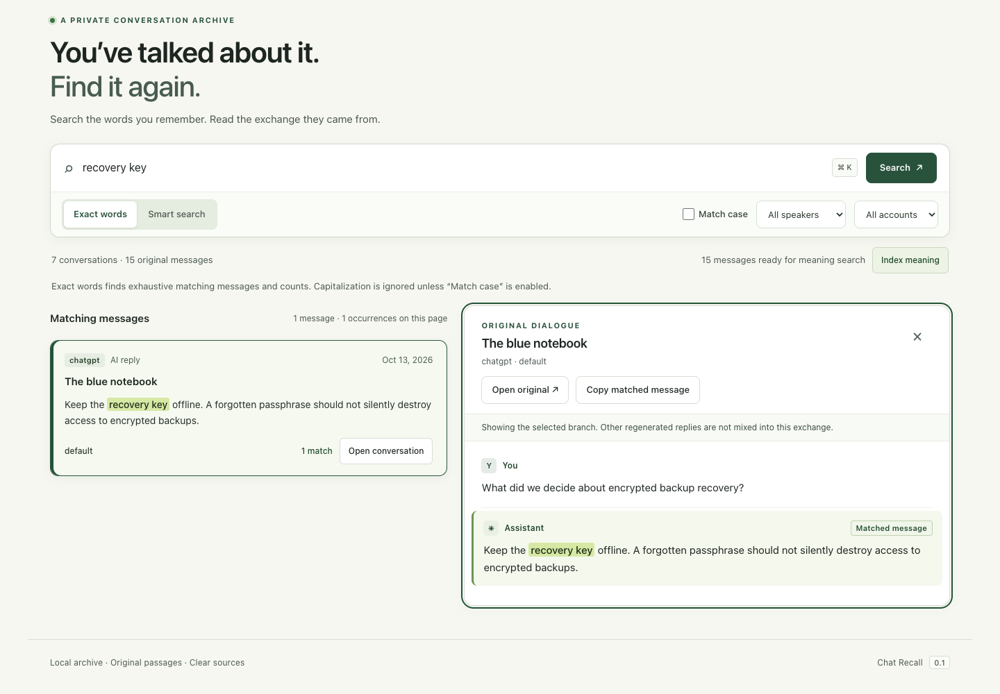
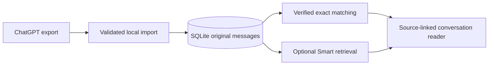

# Chat Recall

**Find the words. Read the conversation.**

A private, local search app for ordinary ChatGPT conversations. Exact search finds
verified text; the reader opens the original exchange and keeps alternate replies
on their own branches.

[](https://github.com/hotpotkiller/chat-recall/actions/workflows/checks.yml)
[](LICENSE)



[Try the demo](#try-it-locally) · [How search works](docs/architecture.md) ·
[Validation](docs/VALIDATION.md) · [Development](docs/DEVELOPMENT.md)

## Two ways to remember

| You remember… | Use | What you get |
|---|---|---|
| A word, quote or error code | **Exact**, the default | Every matching occurrence, original-text highlights and paginated results |
| An idea rather than its wording | **Smart**, optional and experimental | Ranked source passages using keywords and optional local embeddings |
| The exchange around a result | **Conversation reader** | Original dialogue, source links and the correct reply branch |

Exact needs no model, API key, Python package or frontend build step. Smart is an
optional research feature: plausible-looking results still need relevance checks.
See [its design, evaluation and limits](docs/smart-search.md). The current disjoint holdout found the correct passage in the top three for 13/16 queries and missed the quality targets; Exact remains the recommended default.

## Try it locally

Requires **Python 3.11+ with SQLite FTS5**.

```sh
git clone https://github.com/hotpotkiller/chat-recall.git
cd chat-recall
make bootstrap
CHAT_RECALL_DATA_DIR=.runtime/demo python3 -m chat_recall serve --demo --open
```

Open **http://127.0.0.1:8765** if the browser does not open. Try `recovery key`,
`STRASSE`, `ana` or `中文`. The demo uses synthetic conversations; add
`--port 8766` if the default port is occupied.

For your own archive, run `python3 -m chat_recall serve --open` and import an
extracted ChatGPT conversations JSON file through the app. The default storage
location is the platform's private app-data directory.

**New-install defaults:** Exact selected; Smart processing off; automatic browser
importing off. The application never downloads models automatically.

## Built around the original text

- Unicode-aware literal matching, including overlapping occurrences.
- Source/account isolation and branch-aware conversation viewing.
- Safe text rendering: imported markup stays inert.
- Explicit result actions, keyboard navigation and visible focus states.
- Optional versioned local embeddings, with query and document encoding kept separate.
- An experimental paired browser helper with checkpoints and respectful retry behavior.

Search covers successfully imported messages. The browser helper uses undocumented
endpoints; complete account/project/archive coverage and continuous synchronization
are not established features. Cloud reranking is separate, explicitly opt-in, and
can transmit selected passages to its configured provider.

## Small stack, inspectable behavior



Python's standard library handles the service; SQLite FTS5 narrows candidates;
plain HTML, CSS and JavaScript provide the interface. Original Unicode offsets
and conversation ancestry remain the source of truth.

## Evidence, not just examples

```sh
make check
make check-js  # Node.js required; NODE=/path/to/node is supported
make eval      # synthetic exact-search evaluation; no model required
```

Checks cover Unicode and overlapping matches, account/branch isolation, local HTTP
boundaries, asynchronous UI races and temporary Git/worktree review flows.

The recorded 5,000-conversation / 25,000-message synthetic exact-search sample
preserved all oracle-expected matches. Its first-page p95 improved from 906.422 ms
to 133.612 ms in that single-run comparison; these are fixture-specific timings,
not a production guarantee. [Read the reports and reproduction steps](docs/VALIDATION.md).

Smart is evaluated at **passage level**, with original message identities and
Unicode spans, unrelated queries, and conversation-disjoint calibration/holdout
sets. Conversation-level recall is reported separately and is not proof that the
correct passage was found. [See the current results and memory limits](docs/smart-search.md).

## Privacy and maintenance

This repository contains source, synthetic fixtures and reproducible checks.
Personal histories, credentials, databases, model weights and private operator
records are excluded. Use `CHAT_RECALL_DATA_DIR` for an isolated development
archive. Do not put real chats into issues or pull requests.

The project uses a small custom Python/Git coordination workflow. An online lead
assigns bounded worktrees, workers implement, checks execute, and an online review
binds to the exact commit before integration. Codex is the normal lead; AGY can
be selected for takeover. This is not an automatic quota detector or an external
agent-orchestration framework. [Read the maintenance workflow](docs/DEVELOPMENT.md).

Independent prototype; not an official OpenAI product. Licensed under [MIT](LICENSE).
